# EZ Way Insurance website

A custom website for EZ Way Insurance, an independent agency with four offices in Austin, Texas
that sells car, home and business insurance and handles titles, plates, bonds and LLC
registration. The agency wanted a fast site that works on phones, and a quote form as easy as the
big insurers' forms, so that customers send everything an agent needs to price a policy in one go.
Many of its customers have no US driving licence, so the form had to accept any kind of ID.

I designed and built it end to end: the pages and illustrations, the multi-step quote form with
live VIN lookup, the server-side validation and spam protection, the encryption of ID numbers,
the agent dashboard, the email notifications, the Spanish version, and the deployment to shared
hosting plus a Vercel preview for the client. It is plain PHP with no framework and no build step,
so it runs on any cPanel host.

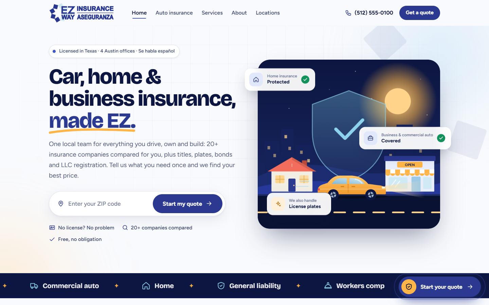

## What it does

**For customers**
- Home, auto insurance, services, about, contact and locations pages, with a floating
  "Start your quote" button on every page that opens the quote form as a pop-up
- One quote form for seven services: personal auto, commercial auto, home and renters, business
  and contractors, bonds, title and registration, and LLC registration
- For auto, seven steps: Service, You, Address, Drivers, Vehicles, Coverage, Review
- Up to 8 drivers and 6 vehicles; driver 1 is filled in from the first step
- Each driver chooses a US licence or another ID (foreign licence, passport, matrícula consular,
  state ID), then the issuing state or country and the number
- Vehicles are entered by VIN only; the form decodes it as you type and shows the year, make,
  model and trim
- Per vehicle: full coverage with a deductible, financed or leased with the lienholder, roadside
  and rental; per policy: PIP, uninsured motorist and the liability limits (commercial auto offers
  higher limits)
- City and state are filled in from the ZIP code; progress survives a page reload; a
  "Larger text" switch for older customers
- Hours for the four offices with a live Open or Closed badge in Austin time

**For agents**
- A dashboard listing every request, with counters for unread, today, this week and won
- Filters by service and by status (New, Contacted, Quote sent, Won, Closed) and a search over
  name, company, phone, email, VIN and reference
- A page per request: contact, drivers, vehicles with VIN status, coverage, call, text and email
  buttons, status, internal notes, print, and next and previous
- ID numbers are masked; an agent reveals one with a click
- A messages inbox for the contact form, a CSV export, and team accounts
- An email to the agency for every request and a confirmation email to the customer, in the
  customer's language

## How the quote form works

- **One definition, four uses:** services, their questions, liability sets, deductibles and ID
  types are defined once in `app/lib/content.php` and `app/lib/quote.php`, and drive the form,
  the server-side validation, the emails and the dashboard
- **VIN lookup:** `api/vin.php` checks the format, asks NHTSA's free vPIC service and records
  whether the check digit is valid; results are cached in a `vin_cache` table. If NHTSA is down
  the customer carries on and the vehicle shows as "Not verified" in the dashboard
- **Saved before anything else:** a request is written to the database before any email is sent,
  so a mail failure never loses a lead; mail errors go to `storage/mail.log`
- **Drafts:** the form state is kept in `sessionStorage` as the customer types, and cleared once
  the request is sent
- **Bilingual by construction:** every string is written as `L('English', 'Español')`, every page
  also lives under `/es/`, and the request remembers its language. The Spanish site is built but
  switched off in `config.php` until the client turns it on

## How it protects customer data

- **Encrypted ID numbers:** licence and ID numbers are encrypted with AES-256-GCM (random 12-byte
  IV, auth tag stored with the ciphertext) under a key kept in `storage/app.key` or `APP_KEY`.
  Emails and the CSV export show only the last four digits
- **Spam and abuse:** browser and server validation, a honeypot field, a minimum fill-time token,
  a same-origin check, per-visitor limits (5 quotes and 5 messages an hour by default, 60 VIN
  lookups an hour) and optional Cloudflare Turnstile. Visitor IPs are stored only as a keyed hash
- **Dashboard sign-in:** 5 failed attempts per account in 15 minutes, or 25 per IP in an hour,
  lock sign-in; sessions are `SameSite=Strict` and regenerated on login; admin forms carry a CSRF
  token
- **Headers:** a Content-Security-Policy, `nosniff`, `SAMEORIGIN` framing, a strict referrer
  policy and a locked-down Permissions-Policy; the dashboard adds `no-store` and `noindex`
- **Blocked folders:** `app/` and `storage/` are denied by `.htaccess` (and by `dev-router.php`
  locally); CSV cells that start with `=`, `+`, `-` or `@` are escaped against formula injection

## Stack

| Layer | Choice |
|---|---|
| Server | PHP 8.1+, no framework, no Composer dependencies |
| Data | SQLite with no setup, or MySQL on cPanel; tables created on first visit |
| Front end | Hand-written HTML, CSS and vanilla JavaScript, custom SVG illustrations |
| Lookups | NHTSA vPIC (VIN), zippopotam.us (ZIP to city and state) |
| Email | PHP `mail()` or SMTP through a mailbox on the agency's domain |
| Hosting | HostGator shared hosting (production), Vercel with `vercel-php` (client preview) |

## Engineering

- **Go-live check:** `tools/smoke-test.sh <url>` checks every page, the 301 and 404 routes, that
  `app/` and `storage/` return 403, HTTPS, the VIN lookup, cache-busted assets, that the agency
  email is not shown publicly and that the dashboard responds; `--send-quote` also submits one
  marked test quote end to end
- **Setup page:** the first visit to `/admin/` checks the PHP version, storage permissions,
  OpenSSL, the database, the notification address and HTTPS, then creates the first account
- **SEO:** titles and descriptions, canonical URLs, an Open Graph image, JSON-LD
  (one InsuranceAgency per office, FAQPage), `sitemap.xml`, `robots.txt` and clean URLs
- **Preview mode:** with `DEMO_MODE=1`, `app/lib/demo.php` creates an agent login and eight sample
  requests so the client could try the dashboard on Vercel, which has no permanent disk
- There are no automated unit tests; the smoke test is the release check

## Screenshots

| | |
|---|---|
| 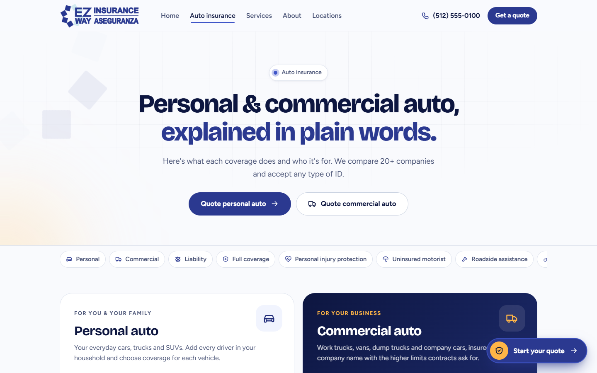 | 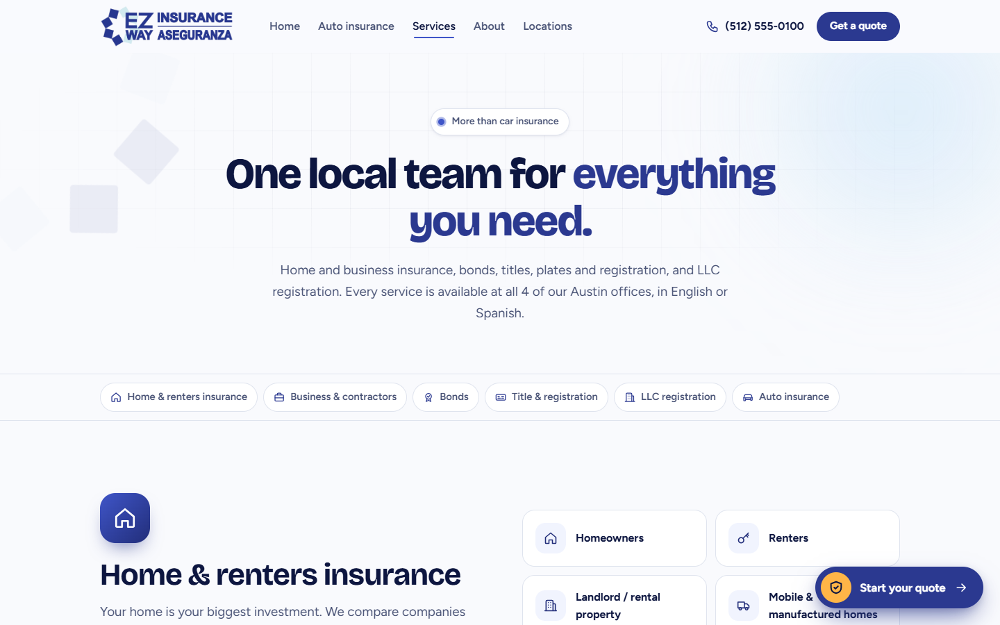 |
| Auto insurance page | Services: home, business, bonds, title and LLC |
| 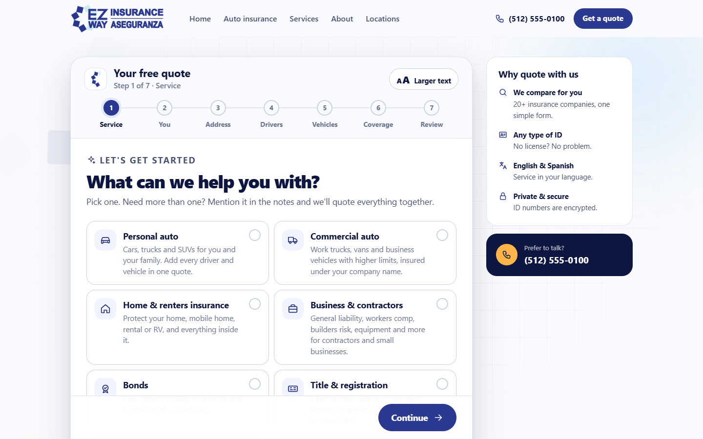 | 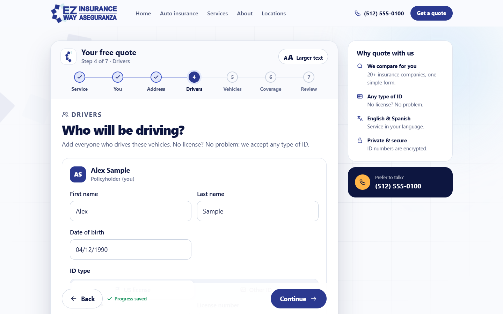 |
| Quote form, step 1: pick a service | Drivers: US licence or other ID, number encrypted |
| 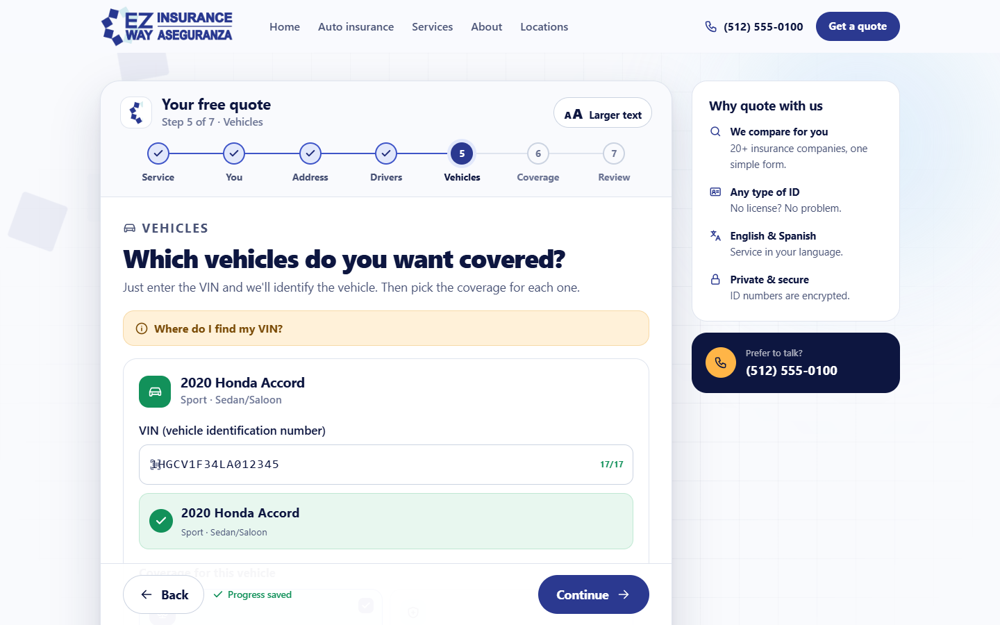 | 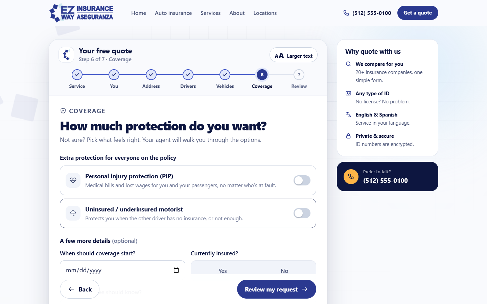 |
| Vehicles: the VIN decoded live from NHTSA | Coverage: PIP, uninsured motorist, current insurer |
| 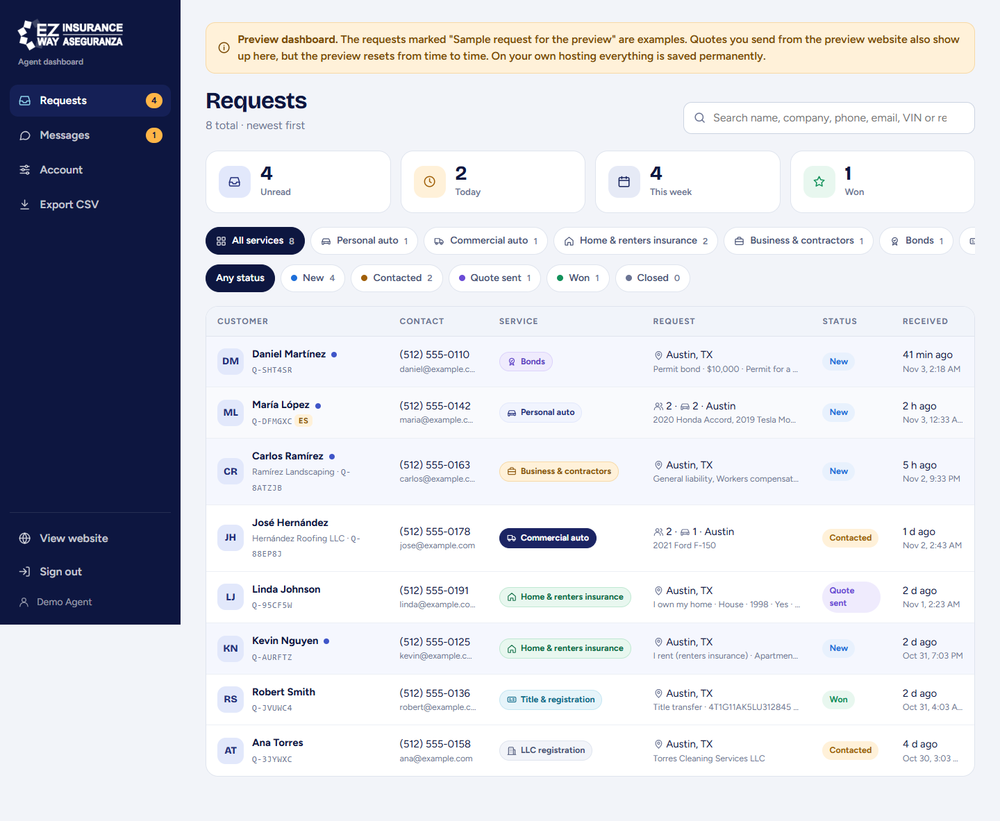 | 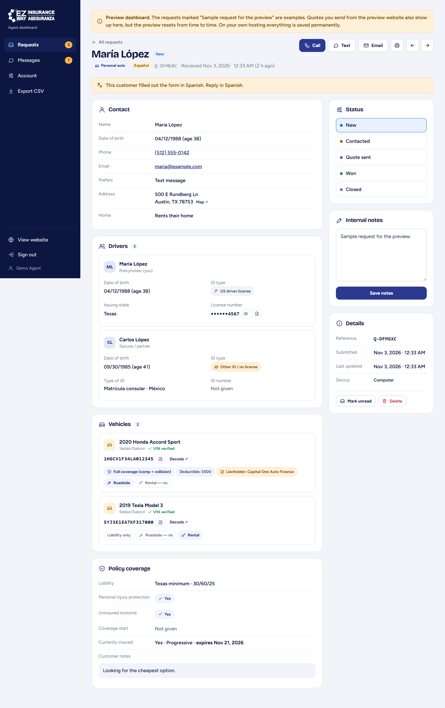 |
| Agent dashboard: counters, filters, requests | A request: drivers, vehicles, coverage, status, notes |
| 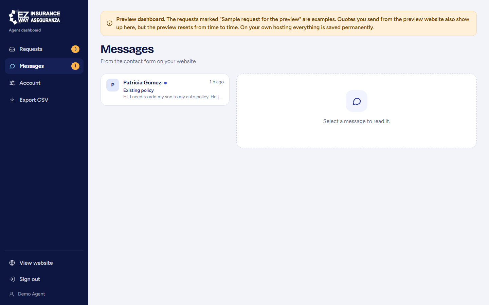 | 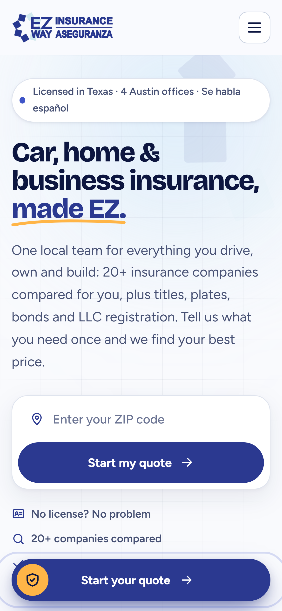 |
| Contact-form inbox | Home page on a phone |

All screenshots show the site running locally on PHP's built-in server in preview mode. Every
customer in the dashboard is a built-in sample with a 555 phone number and an example.com email,
and the agency's phone number was replaced with a 555 number for the screenshots.

## Running it locally

```
php -S localhost:8080 -t public_html dev-router.php
# open http://localhost:8080   (dashboard: http://localhost:8080/admin/)
```

PHP 8.1 or newer with `pdo_sqlite` and `openssl` (on Windows, add
`-d extension=pdo_sqlite` if it is not enabled in `php.ini`). With no configuration it uses
SQLite in `public_html/storage/`, and the first visit to `/admin/` asks you to create an account.
To see the dashboard filled with sample requests, set the preview variables first:

```
DEMO_MODE=1 DEMO_ADMIN_EMAIL=agent@example.com DEMO_ADMIN_PASSWORD=choose-one \
APP_KEY=any-random-32-character-string \
php -S localhost:8080 -t public_html dev-router.php
```

`APP_STORAGE` moves the database, key and logs to another folder. Never set the `DEMO_*`
variables on the real site. Submitting a quote sends email to `mail.notify_to`, so point that at
your own inbox in `public_html/app/config.php` before testing the form end to end.

## Deploying to HostGator

1. In cPanel, set PHP 8.1 or newer, and create a MySQL database and user and a sender mailbox on
   the site's domain.
2. In `public_html/app/config.php`, fill in the `site` details, set `db.driver` to `mysql` with
   the database details, set `mail.notify_to` and `mail.from` (or SMTP), and optionally the
   Turnstile keys.
3. Upload the contents of `public_html/`, including the `.htaccess` files, and make
   `public_html/storage` writable.
4. Run AutoSSL, then uncomment the two "Force HTTPS" lines in `public_html/.htaccess`.
5. Visit `/admin/` to run the setup checks and create the first account.
6. Run `tools/smoke-test.sh https://the-domain --send-quote`.
7. Back up `storage/app.key`: without it, saved ID numbers cannot be decrypted.

The Vercel preview (`vercel.json`, `api/index.php`) keeps its database in `/tmp`, so saved
requests and logins can reset at any time. Use HostGator for the real site.
